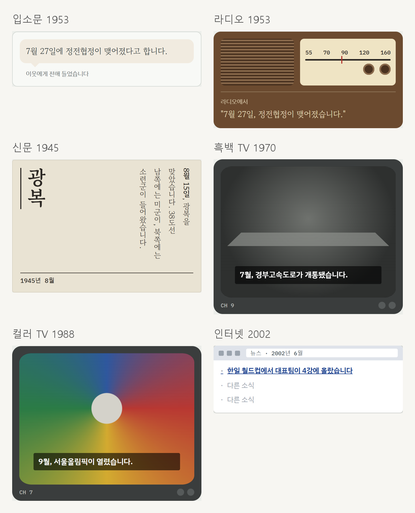

[문화](../era-life-culture/)와 [갈림길](../era-life-choices/) 이야기에 이어, 이틀 동안 만들어 보고 느낀 것을 적어요. 데모는 [era-life-demo.vercel.app](https://era-life-demo.vercel.app/)에서 해 볼 수 있어요.

## 어려웠던 것

이틀 동안 해 보면서 **게임의 디테일을 잡는 게 굉장히 어렵다**고 느꼈어요. 그리고 직접 상호작용하는 부분이 있어야 흥미를 느낀다는 것도요.

LLM을 쓰지 않고 미리 써 둔 문장과 규칙만으로 시뮬레이션을 돌리다 보니, **한 사람의 일생이 자연스럽게 흘러가게 디테일을 잡는 게** 어려웠어요. 일생 90명을 끝까지 읽어 보니 16살에 혼자 살기로 하거나, 1988년 서울에서 남포등을 켜는 것처럼 하나씩 보면 그럴듯한데 이어 읽으면 어색한 곳이 계속 나왔어요.

화면 구성의 중요성도 느꼈어요. 어디가 비어 보이거나 변화하는 게 없으면 **완성도가 떨어져 보이더라고요.** 넓은 화면에서 양옆이 너무 비어 보여서, 바뀐 내 상황이 보이는 "우리 집 그림"을 넣고 왼쪽 칸에는 추억 수첩 카드가 쌓이게 했어요.

## 뿌듯했던 것

그래도 하나를 완성해 본 게 재밌었어요. 가장 뿌듯한 건 두 가지예요.

- 시대별로 큰 흐름을 보여 주는 매개체를 **입소문, 라디오, 신문, 흑백 TV, 컬러 TV, 인터넷**으로 바꿔 가며 보여 준 것
- **"문화"에 집중해서** 간단한 미니게임들을 만들고, 그걸 일생 안에서 직접 해 보게 한 것

## 게임 파일만 공개하기

데모를 공개하려고 보니, 블로그처럼 GitHub Pages에 올리려면 저장소 전체가 공개돼야 했어요. 저장소에는 작업 기록이 다 들어 있어서 **게임 파일만** 공개하고 싶었어요. 그래서 저장소는 비공개로 두고, Vercel에서 게임 폴더만 올렸어요.

처음 올렸을 때 휴대폰으로 들어가니 화면이 엄청 조그맣게 보였어요. 데모 파일이 미리보기 도구 안에서 열릴 것을 전제로 만들어져서, 휴대폰 화면 폭에 맞추라는 설정이 빠져 있었거든요. 그 한 줄을 넣고 고쳤어요.