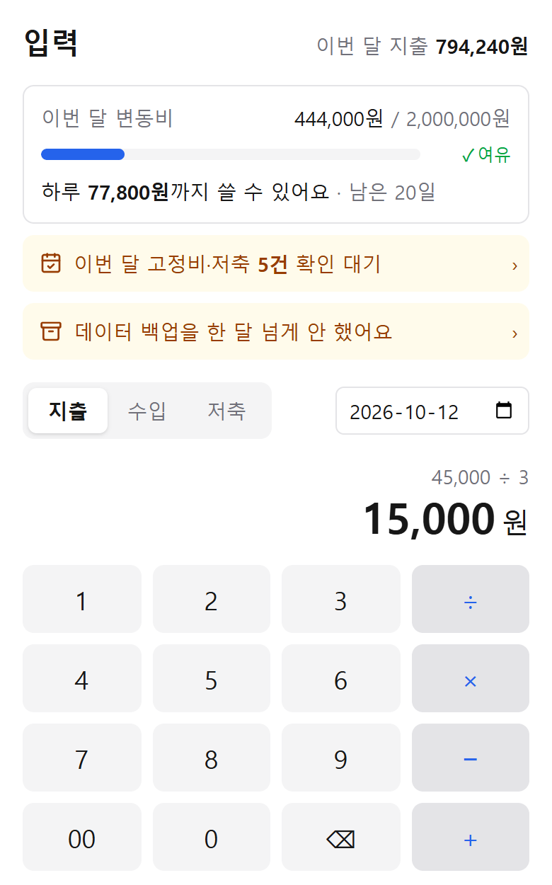

왜 만들었는지는 [가계부를 직접 만든 이유](../why-we-built-it/)에 적었어요. 이번 글은 **무엇을 어떤 순서로 만들었는지**예요. 9월 30일부터 10월 12일까지, 2주 동안의 기록입니다. 만들다 막혔던 이야기는 [따로](../stuck-points/) 모았어요.

화면의 이름과 금액은 모두 가상 데이터예요.

## 첫날: 쌓는 것부터

"이 돈으로 집을 살 수 있나"에 답하려면 먼저 **둘의 숫자가 쌓여야** 했어요. 그래서 계산하는 화면보다 적는 화면을 먼저 만들었어요.

1. 매일 입력: 금액, 카테고리, 결제수단, 누구
2. 고정비: 매달 자동으로 만들어 두고 금액만 확인
3. 월별 자산 잔액과 순자산 추이
4. 통계와 목표
5. 백업, 로그인, 휴대폰 홈 화면에 추가

처음부터 정한 게 하나 있어요. **AI 없이, 정해진 계산 규칙으로만** 동작하게 했어요. 돈 계산은 매번 같은 답이 나와야 하니까요.

## 써 보면서 고친 것

실제로 써 보니 고칠 게 계속 나왔어요. 대부분은 **제가 직접 쓰면서 답답했던 것**이에요. 데이터 백업, 저녁 알림, 고정비 확인도 다 쓰다가 "이게 있어야겠다" 싶어서 넣었어요.

### 순자산만으로는 판단이 안 된다

순자산이 늘어도 그 돈을 당장 쓸 수 있는 건 아니에요. 그래서 순자산 옆에 **유동 가능 금액**을 따로 보여 줘요. 연금이나 ISA는 중도에 깨면 내는 세금만큼 빼고, 청약은 깨지 않을 돈이라 아예 빼요.

### 저축이 안 보인다

처음엔 수입과 지출만 있어서, 적금에 넣은 돈이 어디로 갔는지 안 보였어요. 그래서 저축을 지출이 아닌 **세 번째 흐름**으로 따로 기록하게 했어요.

> 수입 = 지출(고정비 + 변동비) + 저축·투자 + 남은 돈

### 폰에서 쓰기 편하게

- 목록 순서를 ↑↓ 버튼으로 하나씩 옮기는 게 번거로워서, **손잡이를 잡고 끌어서** 옮기게
- 설정이 한 화면에 길게 늘어져 있어서, **요약 카드**를 누르면 세부 화면으로 들어가게

 

### 예비 남편이 짚어 준 것

같이 쓰는 사람이 보니 제가 못 본 게 보였어요.

- **지금 어디에 있는지**: 하위 화면마다 경로 표시(입력 › 고정비 같은)와 뒤로가기를 붙였어요
- **더 잘 보이게**: 메뉴와 링크에 아이콘을 붙이고, 누르는 곳은 버튼 모양으로
- **키패드에 계산기**: 금액을 적으면서 바로 나누고 더할 수 있게 **÷ × − +**

 

그리고 에피소드 하나. 예비 남편이 제가 만든 앱이라고 주위에 자랑하려고 보여 줬는데, 열자마자 **우리 자산이 그대로 나와서** 당황했대요. 그래서 자산 금액은 처음에 흐리게 가려 두고, **눌러야 보이게** 바꿨어요.

## 그리고 내집마련

가장 궁금했던 "이 돈으로 집을 살 수 있나"는 따로 앱을 만들지 않고 **가계부 안에** 넣었어요. 이미 쌓인 자산과 현금 흐름을 그대로 쓰려고요.

- 움직일 수 있는 돈과 대출 조합으로 살 수 있는 최대 집값, 매달 갚을 돈이 수입에 비해 괜찮은지
- 매물 사이트 대신 **실제 거래된 가격**으로 관심 지역 흐름을 봐요
- 예비 남편 아이디어로, 단지마다 **하락장에도 거래가 됐는지** 표시해요

| 날짜 | 만든 것 |
| --- | --- |
| 9월 30일 | 입력, 고정비, 자산, 통계, 목표, 백업, 로그인, 홈 화면 앱 |
| 10월 2일 | 경로 표시, 설정 카드, 유동 가능 금액 |
| 10월 6일 | 정리 메일, 밤 알림, 저축 흐름, 내집마련 계산기와 관심 지역 집값 |
| 10월 7~8일 | 금액 가리기, 사칙연산 키패드, 끌어서 순서 바꾸기, 단지 세대수 |
| 10월 12일 | 단지 검색, 하락장 거래 확인 |

다음은 관심 매물을 직접 넣어 두고, 매물마다 "살 수 있나"를 바로 계산해 보는 기능이에요.
