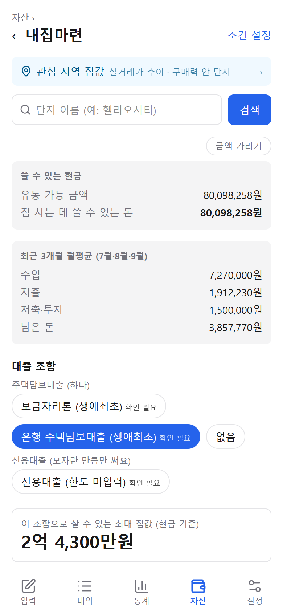
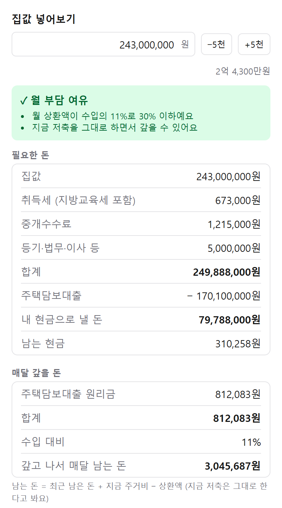
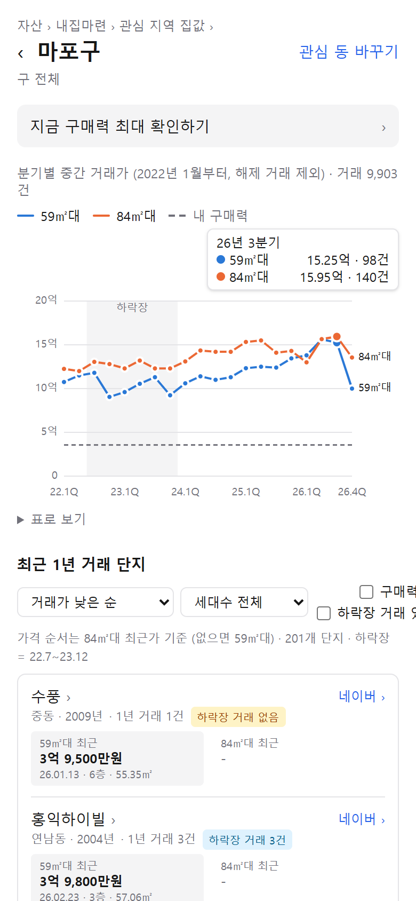

가계부를 만든 이유가 결국 이 질문이었어요. **"그래서 이 돈으로 집을 살 수 있나?"** 그래서 내집마련은 가장 공을 들인 기능이에요. 따로 앱을 만들지 않고 가계부 안에 넣은 건, 이미 쌓아 둔 **자산과 현금 흐름을 그대로 쓰기 위해서**예요.

화면의 금액은 가상 데이터예요.

## 내 돈으로 얼마짜리까지

계산은 세 단계예요.

1. **쓸 수 있는 현금** = 유동 가능 금액 − 비상금
2. **필요한 현금** = 집값 + 취득세 + 중개수수료 + 등기비 − 대출
3. 필요한 현금이 쓸 수 있는 현금 안에 들어오는 **최대 집값**을 찾아요

대출은 주택담보대출 하나에, 모자라는 만큼만 신용대출을 더하는 식으로 조합을 골라 봐요.

 

살 수 있다고 끝이 아니라, 사고 나서 **매달 갚을 수 있는지**도 봐요. 최근 3개월 평균 수입을 기준으로 이렇게 판정해요.

| 판정 | 기준 |
| --- | --- |
| 여유 | 월 상환액이 수입의 30% 이하이고, 지금 저축을 그대로 할 수 있음 |
| 빠듯 | 대출 규제 기준 안이지만, 저축을 줄여야 함 |
| 어려움 | 그 밖 |

대출 한도, 금리, 세율은 자주 바뀌어서 코드에 박지 않고 **설정 값**으로 뒀어요. 처음 넣은 값에는 전부 "확인 필요"를 붙여 두고, 은행에서 확인한 값으로 고치면 표시가 사라져요.

## 실거래 앱은 많지만

실거래가는 다른 부동산 앱에서도 쉽게 볼 수 있어요. 그런데 직접 만들어 써 보니 좋았던 건 두 가지였어요.

- **내가 관심 있는 구와 동의 전체 흐름**을 한 차트로 볼 수 있다는 것
- 그 안에서 **"내 돈 범위에 들어가는 거래"가 얼마나 있는지** 보인다는 것

차트에 내 구매력을 점선으로 같이 그려 두니, 거래가 흐름과 내 돈 사이의 거리가 한눈에 보여요. 단지 목록에서도 구매력 안에 드는 단지를 표시해요. 그래서 **감을 잡기가 좋았어요.**

매물 사이트의 호가 대신 실거래를 쓴 이유도 있어요. 매물 사이트는 공개 API가 없고, 긁어 오는 건 약관 위반이에요. 실거래는 국토교통부가 공개하는 자료라 매달 받아 올 수 있어요.

## 최악의 상황에도 팔 수 있나

단지마다 **하락장(2022년 하반기 ~ 2023년)에도 거래가 됐는지**를 표시해요. 예비 남편 아이디어인데, 보려는 건 **환금성**이에요. 집값이 떨어질 때도 사고팔린 단지라면, 최악의 상황에서도 팔 수 있다는 뜻이니까요.

그래서 "얼마나 떨어졌나"보다 **"그때도 거래가 됐나"를 먼저** 봐요. 그리고 "거래 0건"과 "모름"은 구분했어요.

- 하락장 기간 자료를 아직 안 받은 지역은 0건이 아니라 **"아직 안 받음"**
- 2024년 이후에 지은 단지는 그때 거래가 있을 수 없으니 **"하락장 뒤 준공"**

## 다음

지금은 단지와 거래를 보는 데까지예요. 다음에는 마음에 드는 매물을 직접 넣어 두고, 매물마다 "이 집 살 수 있나"를 바로 계산해 보는 기능을 만들 거예요.
