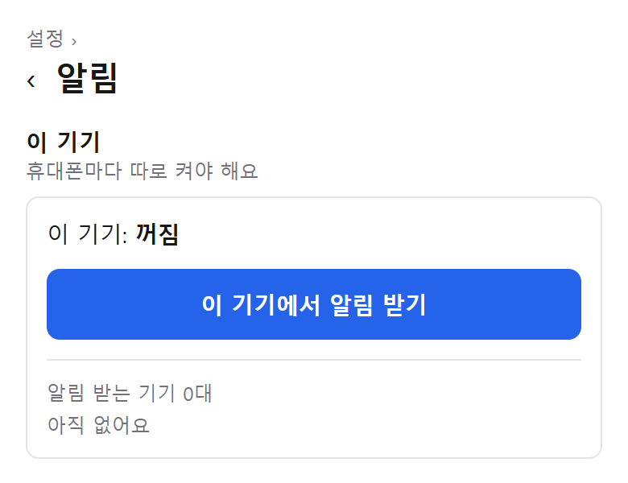

이 가계부는 **매일 자잘한 지출을 적는 것**에서 시작해요. 그런데 매일 적는 걸 잊어버리면 그날 숫자가 비어요. 그래서 밤마다 "오늘 쓴 돈 정리했어?" 하고 알려 주는 알림을 만들었어요.

시각은 **밤 10시**로 정했어요. 하루 일과를 끝내고 자기 전, 휴대폰을 가장 많이 들여다보는 시간이라서요.

조건은 두 가지였어요. 앱스토어에 올리지 않을 것, 돈을 들이지 않을 것.

## 앱스토어 없이 알림 받기

이 가계부는 앱스토어 앱이 아니라, 휴대폰 **홈 화면에 추가해서 쓰는 웹 앱**이에요. 웹 앱도 푸시 알림을 받을 수 있는데, 조건이 있어요.

- 아이폰은 **홈 화면에 추가한 앱으로 열었을 때만** 돼요 (iOS 16.4 이상). 사파리 탭에서는 안 돼요
- 알림 권한은 사람이 버튼을 눌렀을 때만 물어볼 수 있어요. 그래서 설정에 "이 기기에서 알림 받기" 버튼을 뒀어요
- **기기마다 따로** 켜야 해요. 둘이 쓰니까 각자 폰에서 한 번씩

그래서 사용법 문서 맨 앞에 "홈 화면에 추가"를 넣었어요. 이걸 안 하면 아이폰에서는 알림을 켤 방법이 없거든요.

## 무료 서버로 매일 밤 깨우기

알림을 보내려면 매일 밤 서버가 스스로 깨어나야 해요. 서버는 Vercel 무료 플랜을 쓰는데, 예약 작업에 제약이 있어요.

- **하루 한 번까지**만 돌릴 수 있어요
- 정한 시각보다 **최대 59분 늦게** 돌 수 있어요
- 시각은 한국 시간이 아니라 세계 표준시(UTC)로 적어요. 밤 10시는 `0 13 * * *`

그래서 화면과 사용법에는 "밤 10시"가 아니라 **"밤 10시대"**라고 적었어요. 기록하라는 알림이니 몇십 분 늦어도 괜찮아서, 유료 플랜이나 외부 스케줄러는 쓰지 않았어요.

예약 작업이 부르는 주소는 인터넷에 열려 있어서, 아무나 불러서 알림을 보내지 못하게 **비밀 값을 확인**하고 나서야 보내게 했어요.

## 그날 기록에 맞춘 문구

매번 같은 문구면 금방 무시하게 돼요. 그래서 그날 기록을 보고 문구를 바꿔요.

- 오늘 기록이 없으면: **"오늘의 결제 내역을 정리해보세요"**
- 기록이 있으면: **"오늘 3건 기록했어요"**, 빠진 결제가 없는지 확인해 보라고

지난달 말 자산 잔액을 아직 안 넣었으면 한 줄을 덧붙여요. 이건 넣을 때까지 매일 붙어요. 한 번만 알려 주면 또 잊으니까요.

## 기기마다 고르기

알림은 두 종류예요. 밤 10시대 "오늘 기록 정리"와 매달 1일 "월간 정리". 기기마다 받을 알림을 따로 끌 수 있게 했어요.

알림을 끄거나 앱을 지운 기기는 다음에 보낼 때 서버가 알아채고 목록에서 지워요. 다만 **메일 발송이 실패했다는 알림**은 꼭 알아야 하니까, 설정과 상관없이 모든 기기에 가요.

## 써 보니

알림이 생기고 나서 **빠뜨리는 날이 줄었어요**. 알림이 오면 "어, 오늘 거 다 채웠나?" 하고 한 번 더 확인하게 되거든요.

비슷한 걸 만든다면, 이 세 가지만 기억하면 돼요.

1. 아이폰 웹 푸시는 **홈 화면 앱에서만**
2. 무료 예약 작업은 **하루 한 번, 최대 59분 늦게**, 시각은 UTC
3. 알림 주소는 **비밀 값으로 잠그기**
