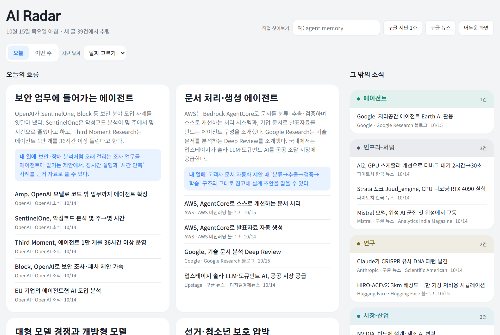
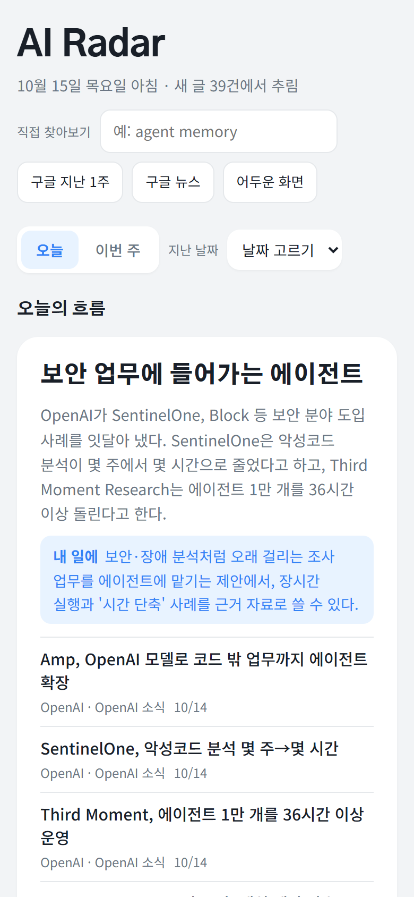
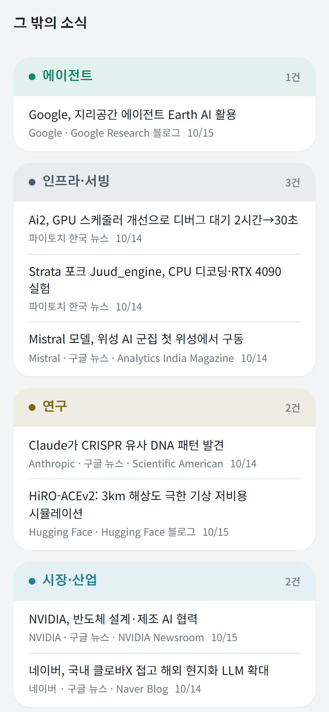
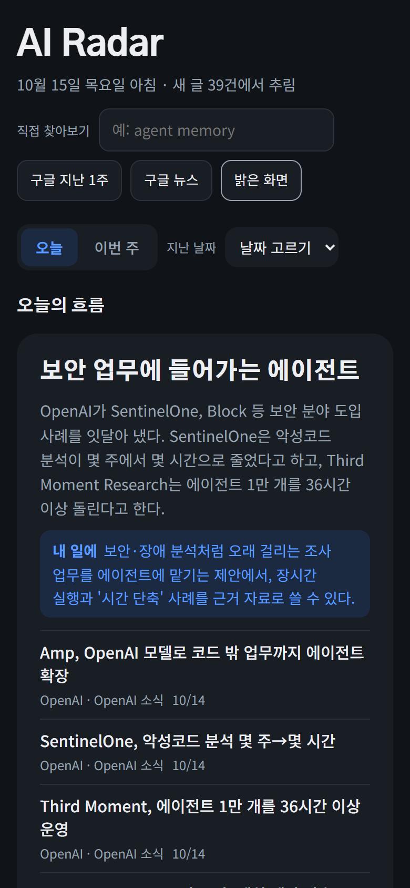

AI 에이전트 일을 하다 보니 새로 나온 기술과 업계 흐름을 계속 따라가야 하는데, 보는 곳이 너무 많고 **앞에 몇 줄 읽으면 흥미가 없어졌어요.** 그래서 한 화면에서 그날의 주요 흐름만 보고, 흥미로운 것만 눌러 원문으로 들어가는 페이지를 만들었어요.

나 혼자 보는 페이지라 주소는 공개하지 않아요. 어떻게 생겼고 어떻게 도는지만 소개할게요.

## 화면

- 맨 위에 **오늘의 흐름** 3~6개가 와요. 여러 곳에서 같은 이야기를 하면 하나로 묶어요
- 흐름마다 무슨 일인지 1~2문장, 그리고 이 소식을 내 일에 어떻게 쓸 수 있는지 **"내 일에"** 한 문장이 붙어요
- 나머지는 **그 밖의 소식**으로, 분야별 덩어리로 나눠요
- 지난 날짜를 골라 볼 수 있고, 금요일에는 **이번 주 요약**이 붙어요

 

폰 홈 화면에 추가하면 앱처럼 열리고, 정리가 끝나면 **폰으로 알림**이 와요.

 

## 어떻게 도나

1. 매일 아침 9시 30분, 스크립트가 출처를 돌며 **처음 보는 글**만 모으고, 같은 소식은 묶고 상관없는 글은 걸러요. 여기까지 **AI를 쓰지 않아요**
2. Claude가 후보의 제목과 첫 문단만 한 번 읽고 흐름으로 묶어 한국어 제목을 붙여요
3. 페이지가 자동으로 배포되고 폰에 알림이 와요

요약은 후보의 제목과 첫 문단에 있는 내용으로만 써요. **숫자나 주장을 지어내지 않아요.**
