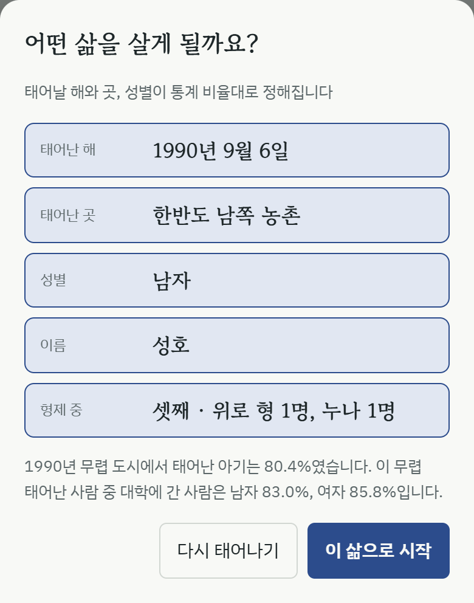
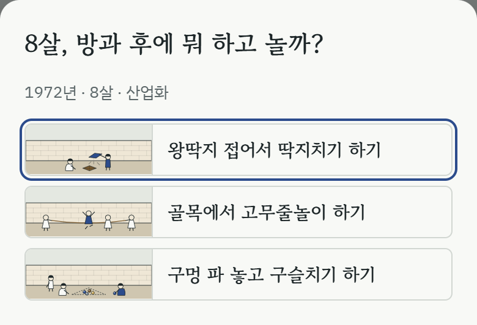
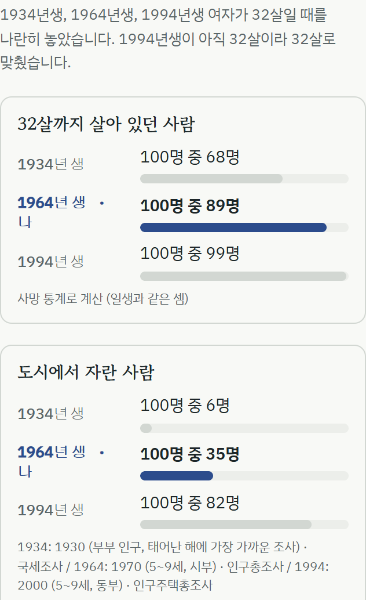

"80억분의 1"이라는 웹 게임처럼, 한 사람의 일생을 짧게 살아 보는 게임을 만들고 있어요. 다른 점은 **낯선 나라 대신 지나간 시대**로 간다는 거예요. 조부모님, 부모님, 그리고 우리 세대가 어떻게 살았는지를 "아, 그때는 이렇게 살았구나" 하고 보게 하는 게 목표예요.

80억분의 1을 해 보고, 한 생애를 따라가며 그 생애에 어떤 일이 있었는지 보는 게 **은근히 힐링되는 느낌**이었어요. 다른 나라 사람의 삶은 매체로 단편적으로만 접하지, 한 사람의 생애 주기를 다 볼 일은 잘 없으니까요. 통계로 접근하면서도 다양한 시뮬레이션을 만든 방식이 눈에 보여서, 형식은 참고하고, 무대는 한국의 지나간 시대로 옮겨 보기로 했어요.

지금 데모를 해 볼 수 있어요: [era-life-demo.vercel.app](https://era-life-demo.vercel.app/)

## 어떻게 흘러가나

1. 1930·1934·1938, 1960·1964·1968, 1990·1994·1998년 가운데 한 해에 태어나요. 태어난 곳, 성별, 이름, 형제가 **그 해의 통계 비율대로** 정해져요
2. 시작할 때 소원을 하나 골라요. 배우고 싶은 만큼 배우기, 고향 지키기, 오래 살기, 그 시절 놀이 다 해 보기 가운데 하나예요
3. 한 해씩 기록이 쌓여요. 학교에 들어가고, 동생이 태어나고, 큰 사건은 그 시절 매체(신문, 라디오, TV, 휴대폰)로 전해져요
4. 갈림길에서 직접 골라요. 놀이와 먹거리 같은 그 시절 문화, 첫 일, 결혼, 사는 곳. **고른 것이 그 뒤의 일생을 바꿔요**
5. 달고나 뽑기, 공기놀이, 딱지치기 같은 놀이는 미니게임으로 직접 해 볼 수 있어요
6. 일생은 세상을 떠나는 해나 올해(2026년)에서 멈춰요. 앞날은 지어내지 않아요

## 끝나면

추억 수첩에 이번 일생에서 겪은 문화가 카드로 모여 있어요. 그다음 **같은 나이, 다른 시대**를 보여 줘요. 같은 자리의 세 해에 태어난 사람이 그 나이에 어땠는지, 살아 있던 사람, 도시에서 자란 사람, 대학에 간 사람, 놀던 것을 나란히 놓아요.

## 지키는 원칙

- **사실과 통계만 쓰고, 견해와 평가는 넣지 않아요.** 사건은 법률, 정부 공식 보고서, 통계에 적힌 것만 써요
- 점수와 순위가 없어요. 결과는 "어떤 시대를 어떻게 지났나"로 끝나요
- 돈 금액은 보여 주지 않아요. 집값이나 모은 돈 대신 그 시절 문화를 겪는 쪽으로 만들었어요
- 플레이 중에는 AI나 서버를 부르지 않아요. 통계 표와 규칙, 미리 써 둔 문장으로만 굴러가요
- 결과 화면에 근거 자료와 "평균 통계로 만든 가상의 삶"이라는 한계를 항상 적어요
