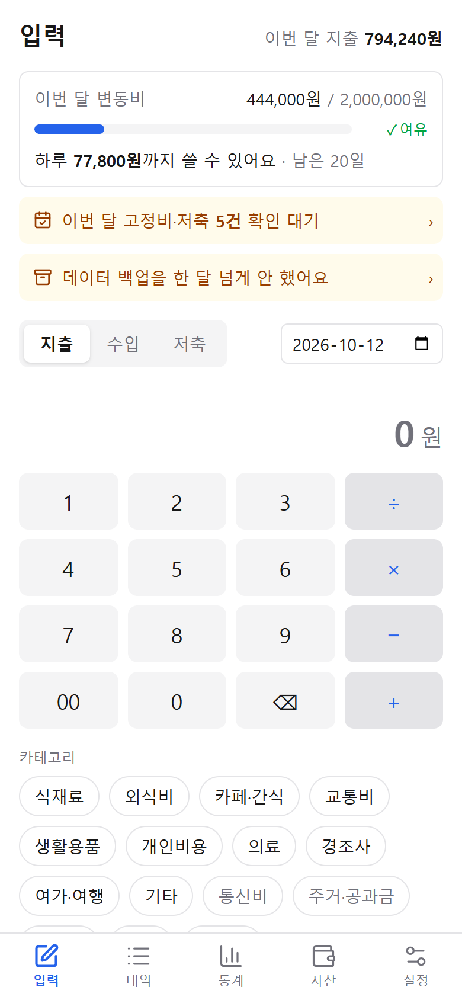
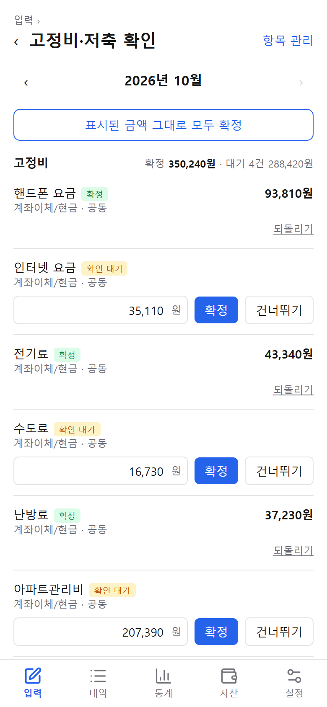
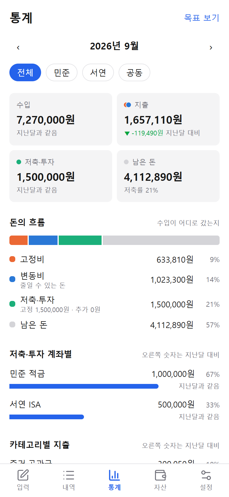
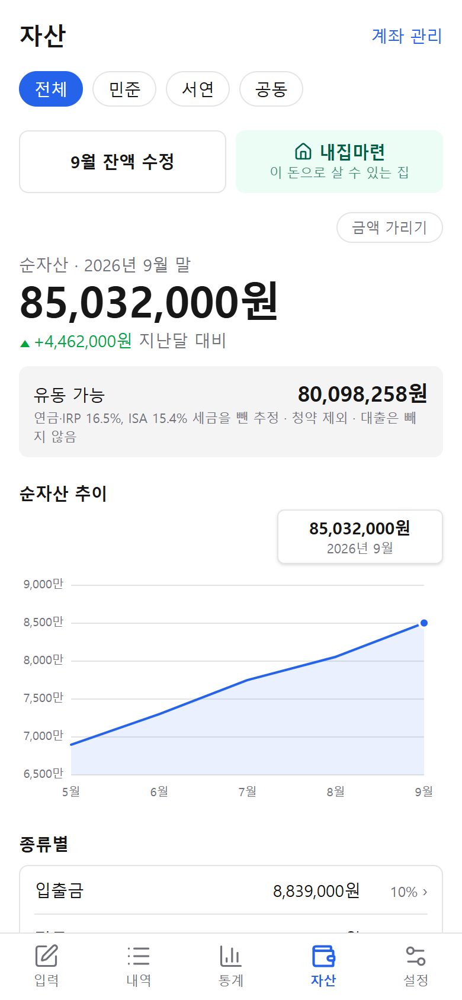
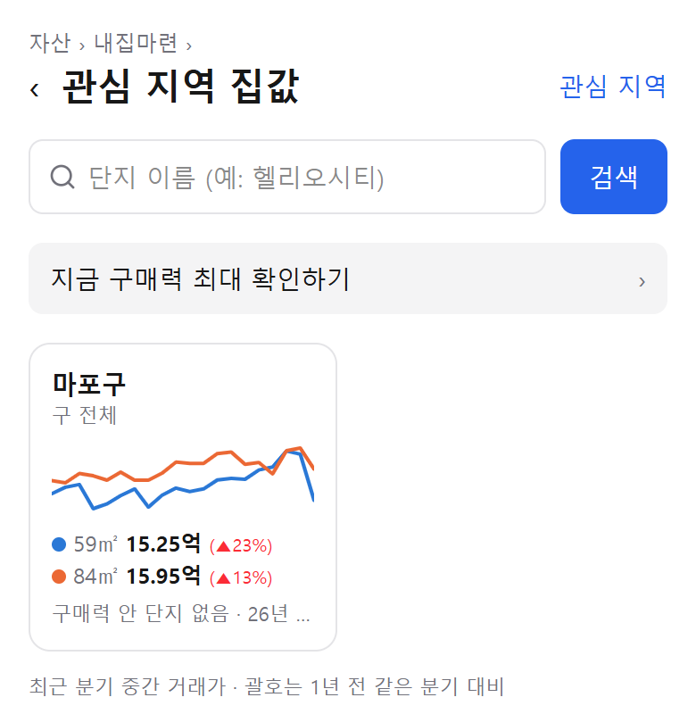
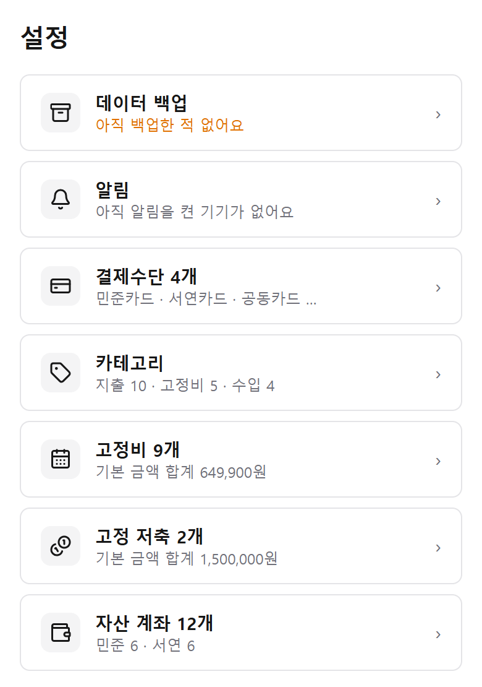
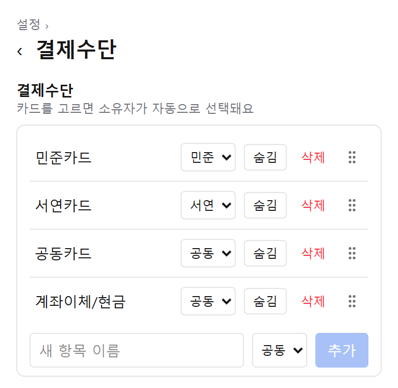
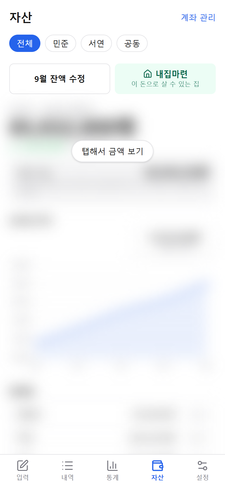

결혼을 준비하면서 SNS를 보면 돈을 합쳐야 한다, 합치지 말아야 한다, 이렇게 해라 저렇게 해라 말이 너무 다양했어요. 정작 우리한테 맞는 답을 내려면 우리 둘의 숫자가 필요했고요. 그런데 구글 스프레드시트나 이미 형식이 정해진 가계부는 실제로 매일 쓰기에는 불편했어요.

그래서 바로바로 앱으로 적고, 필요한 정보를 바로 열어 볼 수 있는 가계부를 직접 만들었어요. 가장 궁금한 건 결국 하나, **"그래서 이 돈으로 집을 살 수 있나?"** 였어요. 그 답을 내려면 먼저 둘의 소비 패턴과 자산 현황을 쌓아야 했습니다.

- 어느 카드, 어느 통장에서 누가 얼마를 어떤 카테고리로 쓰는지
- 고정비는 얼마고 변동비는 얼마인지, 그래서 어디서 줄일 수 있는지
- 이대로 가면 몇 달 뒤, 몇 년 뒤 우리 자산이 얼마일지
- 이 카드로는 무엇을, 저 카드로는 무엇을 결제할지

이런 계산이 서는 가계부, 결국 **미래의 결정을 내리기 위한 가계부**예요. 예비 아내인 제가 만들고, 예비 남편이 써 보면서 준 피드백으로 조금씩 고쳐 왔고, 지금 둘이 실제로 잘 쓰고 있어요. 다른 집도 쓸 수 있게 다듬는 중이고, 어떤 방식으로 내놓을지는 정해지는 대로 여기에 적을게요.

아래 화면의 이름과 금액은 모두 가상 데이터예요.

## 매일은 자잘한 지출만

앱을 열면 바로 입력 화면이에요. 매일은 자잘하게 쓴 돈만 적으면 되고, 저녁에 오늘 기록을 확인하라는 알림이 와요. 결제수단을 고르면 그 카드 주인이 자동으로 선택되고, 둘이 같이 쓴 돈이면 "공동"으로 바꾸면 됩니다.

## 고정비는 확인만

관리비, 통신비, 적금처럼 매달 나가는 돈은 미리 넣어 두었기 때문에, 금액이 바뀌지 않았는지만 보고 확정하면 돼요. 이것만으로 한 달의 현금 흐름이 잡혀요.

## 돈이 어디로 갔는지

수입이 고정비, 변동비, 저축·투자, 남은 돈으로 어떻게 나뉘었는지 한눈에 보여요. 저축은 지출로 치지 않고, 사람별·카드별·카테고리별로 지난달과 비교할 수 있어요.

## 월초에는 자산 잔액

월초에 지난달 말 기준 잔액을 적으면 순자산과 계좌별 흐름이 쌓여요. 연금·ISA처럼 바로 꺼내 쓰기 어려운 돈은 세금을 빼고 계산해서, **지금 실제로 움직일 수 있는 돈**이 얼마인지도 보여 줘요.

## 그래서 집을 살 수 있나

움직일 수 있는 돈과 대출 조합으로 살 수 있는 최대 집값을 계산하고, 집값을 넣어 보면 매달 갚을 돈이 수입에 비해 괜찮은지 알려 줘요.

### 관심 지역 집값

관심 있는 구를 추가하면 국토교통부 **실거래가**를 받아 와요. 매물 호가가 아니라 실제로 거래된 가격이에요. 매달 1일에는 새 거래를 알아서 받아요.

- 59㎡대, 84㎡대 분기별 거래가 흐름과 **내 구매력 선**을 한 차트에
- 최근 1년 동안 거래된 단지 목록: 구매력 안에 드는 단지 표시, 세대수
- 단지마다 **하락장에도 거래가 됐는지**
- 단지 이름으로 검색

 

위 화면의 지역과 거래가는 공개된 실거래 자료이고, 구매력은 가상 데이터로 계산한 값이에요.

## 우리 집에 맞게 바꾸기

자산 계좌, 결제수단, 카테고리, 고정비와 고정 저축을 직접 **추가하고, 이름을 바꾸고, 숨기고**, 손잡이로 끌어서 순서를 바꿀 수 있어요. 이미 기록에 쓰인 항목은 지우는 대신 숨겨서 지난 기록은 그대로 남아요.

 

## 남에게 보여 줄 때

자산과 내집마련 화면의 금액은 처음에 흐리게 가려 두고, 눌러야 보이게 했어요.

